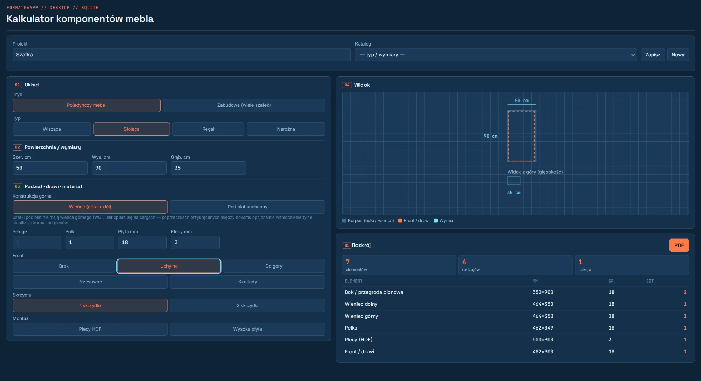
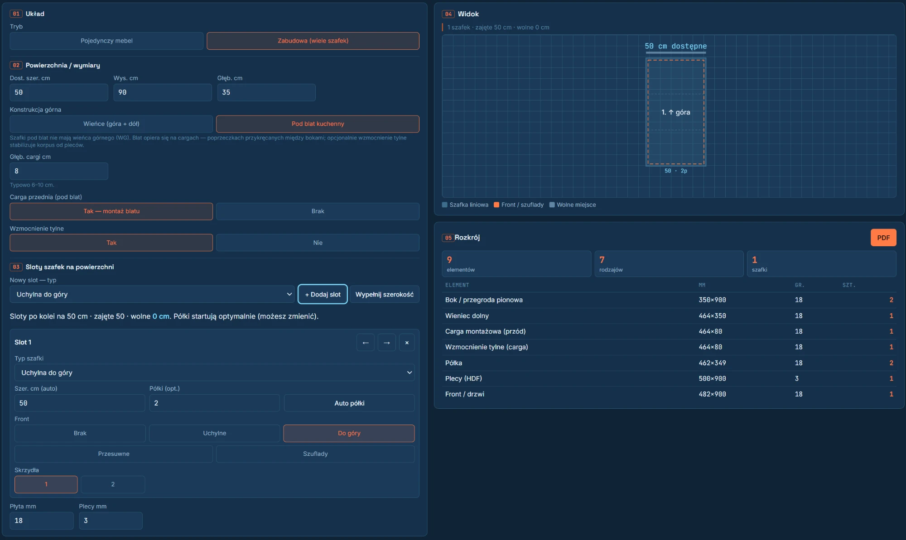
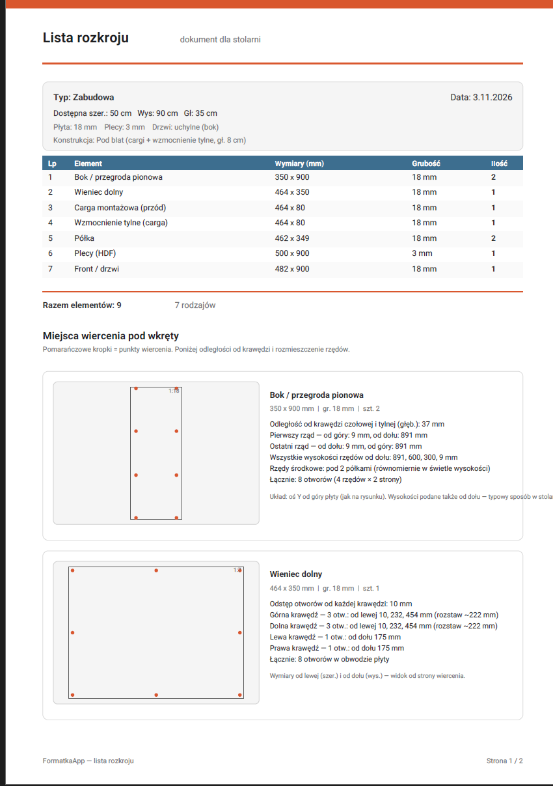

# FormatkaApp

Aplikacja desktopowa do planowania mebli i zabudowy. Po wpisaniu wymiarów i wybraniu konstrukcji liczy formatki (elementy do wycięcia z płyty), pokazuje podgląd mebla i generuje dla stolarni PDF z listą rozkroju i miejscami wiercenia. Działa lokalnie, bez serwera.



## Co robi

- **Dwa tryby:** pojedynczy mebel (szafka wisząca, stojąca, regał, narożna) albo zabudowa z kilku szafek ustawionych obok siebie na dostępnej szerokości.
- **Konstrukcja:** wieńce górny i dolny albo szafka pod blat kuchenny (cargi zamiast wieńca górnego, opcjonalne wzmocnienie tylne), grubość płyty i pleców, półki.
- **Fronty:** brak, uchylne, do góry, przesuwne, szuflady; jedno lub dwa skrzydła.
- **Rozkrój:** lista elementów z wymiarami, grubością i liczbą sztuk, liczona na bieżąco.
- **PDF dla stolarni:** lista rozkroju oraz rysunki elementów z punktami wiercenia pod wkręty i odległościami od krawędzi.
- **Zapis:** projekty, katalog typowych mebli, ustawienia i historia rozkrojów w lokalnej bazie SQLite.





## Technologie

- Electron (proces główny, baza, okno aplikacji)
- React 18 + Vite (interfejs)
- better-sqlite3 (baza danych)
- jsPDF z fontem Roboto (PDF z polskimi znakami)

## Uruchomienie

Wymagania: Node.js 20+, Windows.

```bash
npm install
npm run dev
```

Otwiera się Vite na `127.0.0.1:5173` i okno Electron.

### Instalator Windows

```bash
npm run dist
```

Plik instalatora: `release/FormatkaApp-Setup-0.1.0.exe`

## Dane

Baza SQLite: `%APPDATA%/formatka-app/data/formatka.db`

## Prototyp

`legacy/index.html` to pierwszy prototyp w przeglądarce, od którego zaczęła się logika rozkroju. Zostaje w repozytorium jako punkt odniesienia.

---

Więcej o projekcie: [portfolio](https://portfolio-jakubstachowskii.vercel.app/projekty/formatka-app/)
